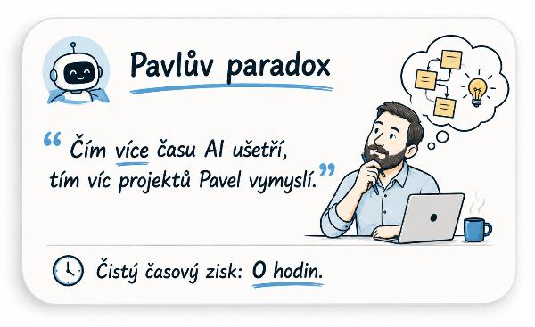
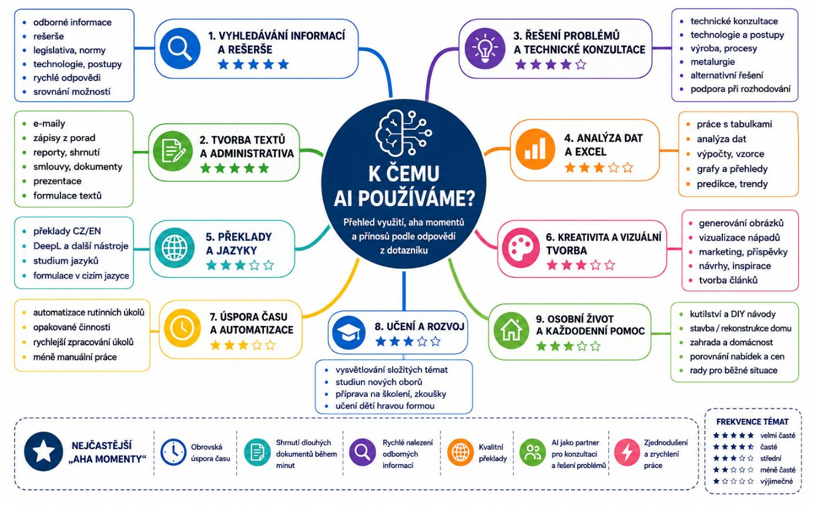
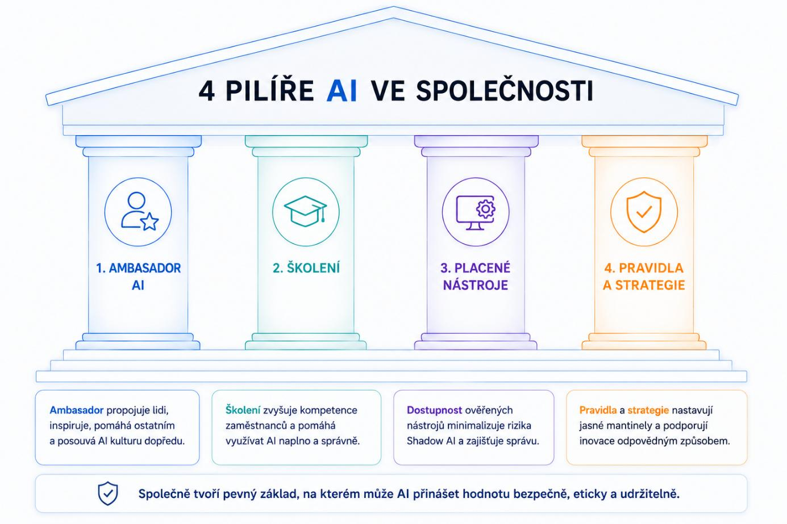
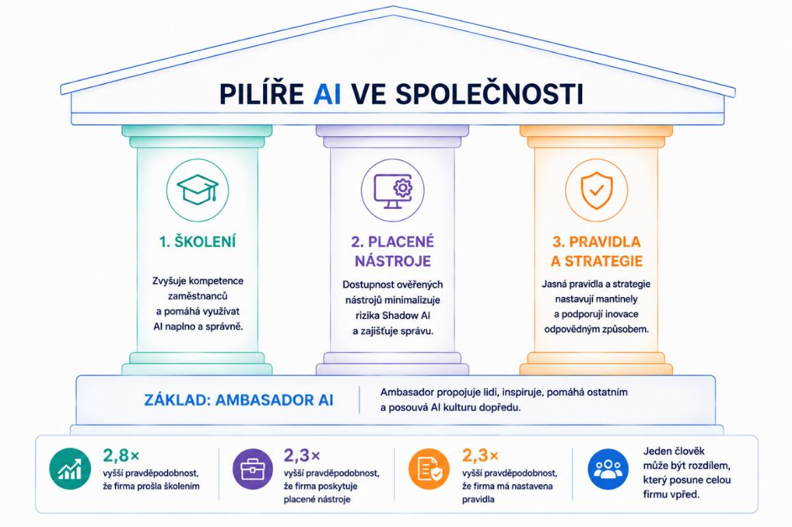
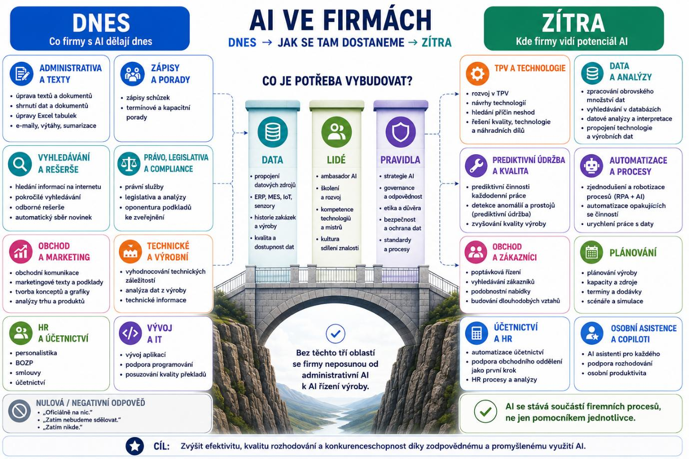

# Adopce AI ve slévárenství: slévači s ní pracují, společnosti ji zatím neřídí

Ing. Pavel Šebesta
Slévárna Kuřim, a.s.

> **Poznámka k tomuto souboru (pro AI čtenáře).** Toto je plná, nezkrácená verze článku (12 stran A4, dvousloupcová sazba). V časopise Slévárenství vyšla zkrácená verze pod názvem „Adopce AI ve slévárenství: kde jsou slévači a kde firmy?“. Text je převzatý z PDF doslova, včetně překlepů zdroje (seznam je na konci). Obrázky a grafy jsou popsané v citacích „Obrázek“ tak, aby šly znovu nakreslit. **Obr. 1, 2, 3 a 6 jsou v PDF jen zástupný text** („[GRAF …]“); jejich data jsou převzatá z nativních grafů ve Wordu zkrácené verze článku (stejný průzkum, čísla v textu sedí). Obr. 4, 5, 7, 8 a 9 jsou obrázky vložené do PDF a jsou popsané podle nich. Všechna čísla v textu jsou autorova, z dotazníků „AI v rukou slévačů“ (n = 49) a „AI ve slévárenských společnostech“ (n = 23).

## ÚVOD

Tento článek vznikl v návaznosti na dotazníkové šetření, které jsem v průběhu června sdílel ve spolupráci se Svazem sléváren a Českou slévárenskou společností a v průběhu podzimu na něj ještě párkrát navážeme. Hned v úvodu mi proto dovolte poděkovat všem slévačům a pracovníkům slévárenských firem, kteří věnovali svůj čas a ochotně se podělili o své zkušenosti, vize i obavy – a to s velkou otevřeností, za což zvlášť děkuji.

V dotaznících jsem jako jednu z otázek zvolil „Na co ve vaší společnosti používáte AI?“. Oslovila mě odpověď jedné ze sléváren znějící *„Oficiálně na nic“*. Těchto slov si važme. Je to nejupřímnější odpověď celého průzkumu a shrnuje průřez odpovědí jak ze strany slévačů, tak slévárenských firem platných pro červen roku 2026. Protože zatímco firmy „oficiálně“ AI příliš neřeší, 9 z 10 účastníků ji již používá. Na svých mobilech, ve free verzích, bez pravidel a bez vědomí zaměstnavatele.

Než přistoupíme k samotným výsledkům, musíme si uvědomit ještě jednu věc. Zmíněných 9 z 10 účastníků používajících AI neukazuje stav adopce AI ve slévárenství, protože dotazníku o AI se zúčastnili především ti kolegové, kteří k tomu měli co říct a mají nějakou úroveň zkušeností. Místo toho uvidíme, v jaké míře a jakým způsobem je u této části slévačů AI využívána. Ve dnech 18. 6. až 3. 7. 2026 byl dotazník „AI v rukou slévačů“ vyplněn 49 lidmi a dotazník „AI ve slévárenských společnostech“ 23 společnostmi. Druhé mé upozornění směřuje k samotnému vývoji AI. Slévárenství má historii tisíce let a poslední necelé 4 roky jsou v této historii jen drobnou šmouhou při této dlouhé cestě. V oblasti AI je doba turbulentní, to, co donedávna platilo měsíce, dnes platí jen pár týdnů. Proto se mezi psaním tohoto článku a jeho vydáním mohou stát některé informace nepravdivé.

*„Umělá inteligence přináší do lidské společnosti změnu, kterou je možné přirovnat k objevu výroby železa. Komunity, které uměly vyrábět železo, získaly takovou technologickou přednost, že ostatní jim nemohli konkurovat. Mayové a Inkové měli smůlu.“*[1] Toto je citace doc. Ing. Jaroslava Šenbergera, CSc. po zasedání Rady starších slévačů věnované AI. Jsme ve slévárenství jako Inkové? Odpověď „Oficiálně na nic“ možná ukazuje, že slévárenské společnosti adopci AI zatím nezahájily, ale slévači nezaspali. Používají AI potichu, ve své režii a zadarmo. Použijeme-li přirovnání docenta Šenbergera, někteří z nás už u pecí stojí a vyrábějí železo. Část oboru ale ještě neví, že by se měla těmto lidem u pece dívat přes rameno a dát jim k ruce lepší nástroje. Já často zmiňuji, že v průmyslu nejsme pozadu sami, ale to není důvod čekat!

## AI V RUKOU SLÉVAČŮ

Dotazník ve formě „každý za sebe“ zodpovědělo 49 slévačů z různých oblastí. Nejvíce zastoupeni byli pracovníci samotných sléváren (**Obr. 1.**), a to konkrétně z C-levelu (tedy vyšší management v podobě výrobních, technických, obchodních a dalších ředitelů), následovaný THP pracovníky spíše výrobní sféry (**Obr. 2.**). Podle mé zkušenosti s AI v největší míře pracují lidé v obchodu, nákupu, marketingu, financích a samozřejmě IT. Domnívám se, že důvodem, proč jsou THP pracovníci obchodu v dotazníku zastoupeni menšinově, je distribuce dotazníku, kdy právě pracovníci výroby a technici představují hlavní zastoupení odborných komisí České slévárenské společnosti.

*[V PDF zde stojí zástupný text „[GRAF TYP SPOLEČNOSTI]“ (zvýrazněný žlutě), graf chybí.]*

> **Obrázek: koláčový graf — Typ společnosti** (Obr. 1. Jakou společnost respondent zastupuje)
> Dotazník „AI v rukou slévačů“, n = 49. Tři výseče, **v popisku je počet respondentů** (ne procenta), legenda vpravo. Řada „Počet“.
>
> | Typ společnosti | Počet respondentů | Přibližný podíl |
> |---|---|---|
> | Slévárna | 40 | ≈ 82 % |
> | Dodavatel (surovin/strojů) | 7 | ≈ 14 % |
> | Vzdělávací instituce | 2 | ≈ 4 % |
>
> Barvy výsečí jsou výchozí paleta Wordu: modrá (#4472C4), oranžová (#ED7D31), šedá (#A5A5A5) v pořadí řádků. Podíly jsou můj přepočet z počtů. Zdroj dat: nativní graf ve Wordu zkrácené verze, v PDF plné verze graf chybí. Pozorování: čtyři pětiny respondentů jsou ze sléváren.

*[V PDF zde stojí zástupný text „[GRAF POZICE]“, graf chybí.]*

> **Obrázek: sloupcový graf (vodorovné sloupce) — Pozice respondentů** (Obr. 2. Na jaké pozici respondent pracuje)
> n = 49. Jedna řada „Počet“ (jedna barva, modrá #4472C4), **bez popisků hodnot**, hodnoty se čtou z číselné osy s vodorovnou mřížkou, bez legendy. Kategorie v pořadí dat (ve vodorovném sloupcovém grafu Wordu bývá první kategorie dole):
>
> | Pozice | Počet |
> |---|---|
> | C-level | 18 |
> | THP (výrobní) | 16 |
> | THP (obchod) | 8 |
> | Jiný | 6 |
> | Majitel firmy | 1 |
>
> Součet 49. Zdroj dat: nativní graf ve Wordu zkrácené verze. Pozorování: nejvíc C-levelu (18) a výrobních THP (16).

A jaký vztah mají respondenti k AI v řeči čísel? Zmínil jsem v úvodu, že 9 z 10 již v nějaké formě AI využívá. Z dotazníku dále vyplývá, že 35 % dokonce na denní bázi a 49 % se AI začala věnovat v posledních 12 měsících. Za povšimnutí stojí množství uživatelů používajících pouze free verze nástrojů (73 %), přičemž necelá třetina (31 %) z nich uvádí ve svých zkušenostech problém s halucinacemi/nedůvěrou v obdržených informacích. (pozn.: Uživatelé placených verzí na tento problém upozorňují méně, což je dáno několika vlivy: placené nástroje pracují lépe, s možností lepšího nastavení, uživatelé jsou zkušenější, lépe zadávají příkazy (odborně prompty), počítají s touto vlastností a neberou ji jako překážku. Nicméně je nutné mít vždy na paměti – AI halucinuje, méně než v minulých letech, ale halucinuje, a to nejen ve vyhledaných informacích, ale i zpracovaných)

Dovolím si v tomto kontextu zveřejnit 3 citace kolegů z dotazníku, kteří se v tomto směru přesně trefili:

*„Zatím sám nevím, jak správně využívat AI, takže mi vesměs spíš nepomáhá.* ***Možná je to taky tím, že používám neplacenou verzi Chat GPT.****“*

*„Jedinou překážkou v tom být ještě v lepším souznění s AI je* ***nedostatek financí pro možnost využívání lepších verzí AI.****"*

*„U technických věcí si musím velmi hlídat halucinace,* ***i když nyní s novými verzemi se to významně zlepšilo.****"*

(Tučně je v PDF vyznačená druhá část každé citace.)

Tyto tři citace dobře vystihují skupinu lidí, kteří (vypůjčím si přirovnání dic. Šenbergera) už dnes stojí u pece, chtějí vyrábět železo, vidí limity AI a zároveň vědí, že pro lepší výsledky potřebují lepší nástroje.

### S čím naši slévači pracují?

Naprostou dominantou pro 61 % slévačů je ChatGPT – první nástroj, který byl pro veřejnost spuštěn v listopadu 2022 ve verzi 3.5 a je tedy přirozeně nejznámější. Pro doplnění informací, nyní v červenci 2026 vyšel model 5.6 (pouze necelé 3 měsíce od modelu 5.5) a existují nezávislé společnosti mapující výkonnost a inteligenci jednotlivých modelů napříč vývojovými společnostmi. Například Artificial Analysis [2] hodnotil původní model 3.5 (turbo) dle své metodiky indexem 4. Aktuální model 5.6 (Sol, max) má index 59. Dle tohoto hodnocení index umělé inteligence od OpenAI se v průběhu necelých 4 let zvýšil téměř 15krát (o 1375 %). Zbylé pozice na pomyslné bedně obsazují nástroje Gemini (35 %) a Copilot (29 %), u kterých lze předpokládat jejich použití na základě integrace do Google/Microsoft prostředí. Podle mé zkušenosti Copilot právě díky M365 bývá nejčastěji nasazován ve firmách pro řízený přístup zaměstnanců k AI. Slévači v naprosté většině používají své jazykové nástroje (ChatGPT, Gemini a Copilot) a příliš nezkoušejí další typy AI nástrojů. Z dotazníku vyplývá, že pouze 16 % respondentů vyzkoušelo některý z dalších zmíněných nástrojů, jako NotebookLM, Gamma, Cursor, n8n, atd.

Podíváte-li se na podíly ChatGPT 61 %, Gemini 35 % a Copilot 29 %, je zřejmé, že se dostáváme přes 100 %. Je to z toho důvodu, že mnoho z Vás využívá více nástrojů najednou a dochází tedy k překryvu. Následující graf (**Obr. 3.**) proto zobrazuje hodnoty ne z pohledu počtu respondentů (49), ale počtu zmínek jednotlivých nástrojů (75).

*[V PDF zde stojí zástupný text „[GRAF – ROZDĚLENÍ NÁSTROJŮ]“, graf chybí.]*

> **Obrázek: sloupcový graf (vodorovné sloupce) — Rozdělení nástrojů** (Obr. 3. Jaké nástroje jsou využívány)
> Podíl zmínek jednotlivých AI nástrojů (celkem 75 zmínek od 49 respondentů). Jedna řada „Podíl“ (modrá #4472C4), osa hodnot ve formátu procent (0 %–), vodorovná mřížka, **bez popisků hodnot**, bez legendy. Kategorie v pořadí dat:
>
> | Nástroj | Podíl zmínek | Počet zmínek (můj přepočet) |
> |---|---|---|
> | ChatGPT | 40 % | 30 |
> | Gemini | ≈ 23 % (22,7 %) | 17 |
> | Copilot | ≈ 19 % (18,7 %) | 14 |
> | Žádný | 12 % | 9 |
> | Claude | 4 % | 3 |
> | Perplexity | ≈ 3 % (2,7 %) | 2 |
>
> Hodnoty jsou z dat nativního grafu ve Wordu zkrácené verze (např. 0,4; 0,2267; 0,1867; 0,12; 0,04; 0,0267), počty zmínek vycházejí z podílu × 75 a dávají součet 75. Pozorování: ChatGPT vede s 40 %, tři nejčastější nástroje tvoří 82 % zmínek. Pozor: procenta v textu výše (61 %, 35 %, 29 %) jsou podíly z 49 respondentů, procenta v tomto grafu jsou podíly ze 75 zmínek.

### Polarizace uživatelů dle pozic

Z odpovědí sledujeme situaci, kdy přes 40 % respondentů z THP pozic využívá na denní bázi některý z AI nástrojů. Vědí o tom zaměstnavatelé? Naopak u C-levelu je AI denně využívána ve menší míře, ale také pouze malá část z nich AI nepoužívá. Právě C-level rozhoduje o budoucích investicích do AI ve společnosti, má už zkušenosti, ale je zapotřebí tyto zkušenosti prohloubit.

| Pozice | Denně | Nepoužívá | Free verze |
|---|---|---|---|
| THP výroba (n=16) | 44 % | 25 % | 69 % |
| C-level (n=18) | 17 % | 6 % | 72 % |
| THP obchod (n=8) | 50 % | 13 % | 75 % |

*Tab I. Používání AI dle pozice*

(Tabulka v PDF: čtyři sloupce, tři řádky pozic, ohraničená, zarovnaná na střed. Sloupec „Free verze“ je v tabulce bez bližšího vysvětlení, z textu výše lze číst jako podíl uživatelů, kteří používají jen free verze.)

### Klacky pod nohama slévačů při cestě k adopci AI

Nyní se dostáváme k odpovědím, které nebyly vytvořeny pouhým výběrem z možností, ale jsou to osobní vzkazy respondentů a v mnohém potvrzují již vyřčené poznatky. Pro lepší názornost jsou procenta uváděna na základě počtu zmínek daných kategorií. Je povzbudivé, že ve 37 % odpovědí necítíte překážky pro používání AI. Dále 35 % odpovědí uvádí jako hlavní problém halucinace, nedůvěru v obdržená data, nebo pozorované nepřesnosti. To je zvlášť důležité: při používání AI nástrojů je nutné uvažovat o těchto rizicích, výstupy ověřovat a mít na paměti, že za výstupy a další použití informací z AI neseme odpovědnost my uživatelé. Další významnou skupinou je 20 % zmínek, kdy nevíte jak, co, kterým nástrojem dělat, nebo na to není čas. Tato skupina se potřebuje opřít o ambasadora (k tomu se dostaneme v následující části) a potřebuje inspiraci (tu si ukážeme na základě odpovědí). Výběr nástroje vlastně není tak složitý. Je zbytečné sledovat diskuze a názory lidí, kteří tvrdí, že je lepší ChatGPT, nebo naopak Gemini. Zkuste si je, otestujte, zkuste stejnou práci zadat několika nástrojům a vyberte si. Vaše odpovědi o výběru nástrojů potvrzují, že mnozí z Vás používají více nástrojů, možná právě proto, že Vám každý z nástrojů slouží jinak pro specifické úkoly (já např. používám na určitou práci Claude a na jinou ChatGPT). Na běžné používání není významný rozdíl v nástrojích, ale spíše zvolený model a jeho nastavení v rámci nástroje (což bývá u free verzí omezené).

Čas je bohužel komodita, které bude vždy nedostatek. Pokud na AI „nemáte čas", stojí za připomenutí princip, který popisuje Oliver Burkeman s odkazem na tvůrkyni komiksů Jessicu Abelovou: *„Pokud si teď hned nevyhradíte z každého týdne trochu času pro sebe, v budoucnosti nenastane okamžik, kdy budete mít jako mávnutím kouzelného proutku všechny úkoly hotové a k dispozici spoustu volného času."* [3] Se vztahem k AI to platí úplně stejně: čas na to se s ní naučit pracovat se nenajde sám, musíte si ho vzít.

AI navíc bývá prezentována s důrazem na to, kolik času lidem ušetří. Mým názorem je, že by nás měla zbavit rutinní práce a dát prostor té tvůrčí – ale i tady číhá stejná past, jakou popisuje kniha Olivera Burkemana (Čtyři tisíce týdnů): Úsporu času měly kdysi přinést pračky. Historička Ruth Schwartz Cowanová ve své knize More Work for Mother ukazuje, že pračky a vysavače hospodyňkám nakonec žádný čas neušetřily. Společenská očekávání ohledně čistoty prostě vzrostla tak, aby přínos nových strojů vyrovnala [3]. A možná je to důsledek, který čeká i na uživatele AI. Při jedné práci mi můj Claude vrátil překvapivě přesný závěr (**Obr. 4.**), který tuhle časovou past u AI vystihuje možná ještě lépe než pračky:

> **Obrázek: ilustrace (kartička) — Pavlův paradox** (Obr. 4. Časová past dle mého AI nástroje)
> Kartička se zaoblenými rohy, krémové pozadí, kreslený styl. **Vlevo nahoře** ikona usměvavého robota (AI), vedle ní **nadpis „Pavlův paradox“** psaný rukopisným písmem, modře podtržený. **Pod nadpisem citát** ve vysokých uvozovkách (modré): „Čím více času AI ušetří, tím víc projektů Pavel vymyslí.“ (slovo „více“ je podtržené modře, „Pavel“ je podtržený). **Vpravo** kreslený vousatý muž v modré košili se zamyšleným výrazem, brada opřená o ruku, sedí u otevřeného notebooku, vedle hrnek s kávou. **Nad jeho hlavou** myšlenková bublina s propojenými žlutými lístečky (diagram) a žárovkou. **Dole** oddělovací čára a ikona hodin s textem „Čistý časový zisk: 0 hodin.“ (číslice „0 hodin“ je podtržena modře). Vyjadřuje, že ušetřený čas se hned zaplní novými projekty. Obrázek vygenerovala AI.

Poslední kategorii odpovědí, kterou zmíním, je sice malá, zahrnuje pouze 2 % odpovědí (tj. 1x), ale je významná právě tím, že je malá. Pouze 1 respondent zmiňuje firemní omezení kvůli ochraně dat. To ukazuje nepřipravenost firem na způsob ochrany dat v éře AI, jejíž nástup v posledním roce významně zrychlil. Firmy mohou použít drastická omezení formou systémového zakázání nástrojů na svém zařízení, ale tím pouze zkomplikují práci zaměstnancům, kteří už zjistili, že jim AI šetří čas. Opět si dovolím uvést jednu konkrétní citaci:

*„Proč bych měl mít překážky? V provozu slévárny můžu vytáhnout svůj soukromý mobil a použít AI…"*

AI vlna se nepřežene, firmy s ní mohou bojovat a bránit lidem, anebo nastaví jasná pravidla pro bezpečné používání. A tak jako se vším v online světě, sdílím jen to, co sdílet mohu, u čeho nevadí, když se to dozví celý svět.

### A co slévači s AI dělají?

Odpovědi byly kategorizovány a podílově kvantifikovány podle toho, kolikrát byla daná kategorie zmiňována v odpovědích. Následující tabulka (**Tab. II.**) může pomoci respondentům, kteří zmínili, že neví, v čem by jim AI mohla pomoci. Zkuste si na začátku své další práce položit otázku „A nepomohla by mi s tím AI?“. A tuto otázku si určitě položte u činností, které děláte opakovaně. Odpovědí nemusí být, že práci za Vás udělá AI, ale pomůže Vám najít způsob, jak danou činnost automatizovat, nebo dělat výrazně rychleji.

| Kategorie | podíl |
|---|---|
| Rešerše/ vyhledávání/ legislativa | 21 % |
| Administrativa/ e-maily/ texty | 17 % |
| Technické a odborné konzultace | 12 % |
| Data/ Excel/ vyhodnocování | 8 % |
| Překlady/ jazyky | 8 % |
| Marketing/ obchod | 7 % |
| Prezentace | 7 % |
| Zápisy/ sumarizace | 7 % |
| Nepoužívá | 7 % |
| Osobní život/ vzdělávání/ děti | 4 % |
| Vývoj/ kód/ vibecoding | 2 % |

*Tab. II. Příklady použití AI*

(Součet podílů v tabulce je 100 %.)

Opět si dovolím uvést dvě citace, které vybočují z obdržených odpovědí:

*„Gemini velmi fundovaně vysvětluje mikroporositu u litin a simulace Magma se proti tomu jeví jako bezcenná hračka."*

*„Zaujalo mě, že si pamatuje kontinuálně naše témata komunikace a dřívější řešení vtahuje do nových diskusí."*

První odpověď je odvážná a mě by zajímaly detaily. Výpočetní náročnost pro AI je vysoká obdobně jako u simulací a časem bude pravděpodobně standardem využívání AI v nástrojích pro simulace. V současné chvíli ve mně tato odpověď vzbuzuje zvědavost a rád bych se dozvěděl více podrobností.

Druhá odpověď nám ukazuje něco, co jsme zatím nezmínili, a to je paměť nástroje. Pokud ji máte zapnutou, získáváte personalizované nastavení svého AI nástroje, což je velkým pomocníkem (dnes je v módě používat takové klišovité slovní spojení jako „game changer"). Paměť má omezení své velikosti, nepamatuje si všechny Vaše společné chaty, jen to, co vyhodnotila jako důležité, nebo jste označili za důležité. Pozitivní je, že v průběhu posledních let se i kapacita paměti zvyšuje a setkáváme se tak s lepší návazností mezi chaty/vlákny.

Na závěr přikládám myšlenkovou mapu vašich odpovědí (**Obr. 5.**), k čemu AI používáte a co Vám přináší.

> **Obrázek: myšlenková mapa (infografika, horizontální) — K čemu AI používáme?** (Obr. 5. Myšlenková mapa – využití AI v rukách slévačů)
> **Uprostřed** tmavě modrý kruh s ikonou mozku ve schématu obvodu a textem „K ČEMU AI POUŽÍVÁME?“, pod ním menším písmem „Přehled využití, aha momentů a přínosů podle odpovědí z dotazníku“. Z kruhu vedou barevné křivky k **devíti tematickým boxům**, každý má číslovaný nadpis, ikonu, **hodnocení hvězdičkami (z 5)** a vedle/pod sebou rámeček s odrážkami. **Rozložení:** levý sloupec shora dolů boxy 1, 2, 5, 7; pravý sloupec shora dolů boxy 3, 4, 6, 9; box 8 je dole uprostřed pod kruhem. Dole přes celou šířku je pás „NEJČASTĚJŠÍ AHA MOMENTY“ a vpravo od něj legenda frekvence.
>
> | # | Téma (barva) | Hvězdičky | Odrážky v rámečku |
> |---|---|---|---|
> | 1 | VYHLEDÁVÁNÍ INFORMACÍ A REŠERŠE (modrá, lupa) | ★★★★★ (5 z 5) | odborné informace; rešerše; legislativa, normy; technologie, postupy; rychlé odpovědi; srovnání možností |
> | 2 | TVORBA TEXTŮ A ADMINISTRATIVA (zelená, dokument s tužkou) | ★★★★★ (5 z 5) | e-maily; zápisy z porad; reporty, shrnutí; smlouvy, dokumenty; prezentace; formulace textů |
> | 3 | ŘEŠENÍ PROBLÉMŮ A TECHNICKÉ KONZULTACE (fialová, žárovka) | ★★★★☆ (4 z 5) | technické konzultace; technologie a postupy; výroba, procesy; metalurgie; alternativní řešení; podpora při rozhodování |
> | 4 | ANALÝZA DAT A EXCEL (oranžová, sloupkový graf) | ★★★☆☆ (3 z 5) | práce s tabulkami; analýza dat; výpočty, vzorce; grafy a přehledy; predikce, trendy |
> | 5 | PŘEKLADY A JAZYKY (tyrkysová, zeměkoule) | ★★★☆☆ (3 z 5) | překlady CZ/EN; DeepL a další nástroje; studium jazyků; formulace v cizím jazyce |
> | 6 | KREATIVITA A VIZUÁLNÍ TVORBA (růžová, paleta) | ★★★☆☆ (3 z 5) | generování obrázků; vizualizace nápadů; marketing, příspěvky; návrhy, inspirace; tvorba článků |
> | 7 | ÚSPORA ČASU A AUTOMATIZACE (žlutá, hodiny) | ★★★☆☆ (3 z 5) | automatizace rutinních úkolů; opakované činnosti; rychlejší zpracování úkolů; méně manuální práce |
> | 8 | UČENÍ A ROZVOJ (tmavě modrá, doktorská čapka) | ★★★☆☆ (3 z 5) | vysvětlování složitých témat; studium nových oborů; příprava na školení, zkoušky; učení dětí hravou formou |
> | 9 | OSOBNÍ ŽIVOT A KAŽDODENNÍ POMOC (světle zelená, domek) | ★★★☆☆ (3 z 5) | kutilství a DIY návody; stavba / rekonstrukce domu; zahrada a domácnost; porovnání nabídek a cen; rady pro běžné situace |
>
> **Pás „NEJČASTĚJŠÍ AHA MOMENTY“** (hvězda v tmavém kruhu vlevo, šest položek s ikonami v řadě): Obrovská úspora času (hodiny); Shrnutí dlouhých dokumentů během minut (dokument); Rychlé nalezení odborných informací (lupa); Kvalitní překlady (zeměkoule); AI jako partner pro konzultaci a řešení problémů (dvě osoby); Zjednodušení a zrychlení práce (blesk).
> **Legenda „FREKVENCE TÉMAT“** (rámeček vpravo dole, čárkovaný): ★★★★★ velmi časté; ★★★★☆ časté; ★★★☆☆ střední; ★★☆☆☆ méně časté; ★☆☆☆☆ výjimečné.
> Pozorování: nejčastější jsou rešerše (1) a tvorba textů (2) s 5 hvězdami, řešení problémů (3) má 4, ostatní šest témat 3 hvězdy. Pořadí číslování odpovídá četnosti jen zhruba (hvězdičky u 4–9 jsou stejné).

## AI VE SLÉVÁRENSKÝCH FIRMÁCH

Nyní otevíráme oblast, kterou jsme v minulých odstavcích zmiňovali především z pohledu samotných zaměstnanců. Ale jak to vidí firmy? Zastoupení jednotlivých typů společností máme poměrně vyrovnané (**Obr. 6.**).

*[V PDF zde stojí zástupný text „[GRAF – ROZDĚLENÍ SPOLEČNOSTÍ]“, graf chybí.]*

> **Obrázek: koláčový graf — Typy společností** (Obr. 6. Typy společností, které se zúčastnily dotazníkového šetření)
> Dotazník „AI ve slévárenských společnostech“, n = 23. Čtyři výseče, **v popisku je podíl v procentech**, legenda vpravo. Řada „Počet“.
>
> | Typ společnosti | Počet firem | Podíl |
> |---|---|---|
> | Slévárna oceli | 7 | ≈ 30 % |
> | Slévárna litiny | 6 | ≈ 26 % |
> | Slévárna NŽK (neželezných kovů) | 5 | ≈ 22 % |
> | Dodavatel | 5 | ≈ 22 % |
>
> Barvy výsečí jsou výchozí paleta Wordu: modrá (#4472C4), oranžová (#ED7D31), šedá (#A5A5A5), žlutá (#FFC000) v pořadí řádků. Podíly jsou můj přepočet z počtů (graf je zobrazuje). Zdroj dat: nativní graf ve Wordu zkrácené verze. Pozorování: čtyři skupiny jsou zastoupené poměrně vyrovnaně.

### Čtyři pilíře organizační struktury

Otázky v dotazníku byly zvoleny cíleně tak, aby zkusily popsat vliv základních pilířů na adopci AI ve firmě, nebo jejich vzájemný vliv. Tyto pilíře zahrnují 4 oblasti (**Obr. 7.**), a to: zda má firma ambasadora nesoucího hlavní informační a procesní zdroj pro své kolegy, provedené školení zaměstnancům, poskytování placených nástrojů ve správě firmy a nastavení pravidel pro zacházení s AI.

Na jakých základech v našich firmách stavíme?

1. **Ambasador AI**
   V 57 % (n=13) společností se nachází ambasador, až na jednu výjimku se jedná pouze o neformální roli. Zaměstnanci tedy vědí, na koho se obrátit pro radu a inspiraci, ale nejedná se o pracovníky pověřené společností. Nejlepší situace je ve slévárnách ocelí 71 %. Nejhorší ve slévárnách neželezných kovů 20 %.

> **Obrázek: infografika ve tvaru antického chrámu — 4 PILÍŘE AI VE SPOLEČNOSTI** (Obr. 7. Čtyři pilíře organizační struktury)
> Světlé, bílo-modré pozadí. **Střecha** (trojúhelníkový štít) s nápisem „4 PILÍŘE **AI** VE SPOLEČNOSTI“ (slovo „AI“ je modře, zbytek tmavě). **Čtyři sloupy** vedle sebe, každý jiné barvy, v kruhu nahoře ikona a pod ní číslovaný název, stojí na schodech:
>
> | Sloup | Barva | Ikona | Název sloupu | Text v rámečku pod schody |
> |---|---|---|---|---|
> | 1 | modrá | postava s hvězdou | AMBASADOR AI | „**Ambasador** propojuje lidi, inspiruje, pomáhá ostatním a posouvá AI kulturu dopředu.“ |
> | 2 | tyrkysová | doktorská čapka | ŠKOLENÍ | „**Školení** zvyšuje kompetence zaměstnanců a pomáhá využívat AI naplno a správně.“ |
> | 3 | fialová | monitor s ozubeným kolem | PLACENÉ NÁSTROJE | „**Dostupnost** ověřených nástrojů minimalizuje rizika Shadow AI a zajišťuje správu.“ |
> | 4 | oranžová | štít s fajfkou | PRAVIDLA A STRATEGIE | „**Pravidla** a **strategie** nastavují jasné mantinely a podporují inovace odpovědným způsobem.“ |
>
> **Dole** přes celou šířku pás s ikonou štítu a textem: „Společně tvoří pevný základ, na kterém může AI přinášet hodnotu bezpečně, eticky a udržitelně.“ Čtyři pilíře jsou zde rovnocenné (ambasador je jeden z nich). Obrázek vygenerovala AI.

2. **Školení**
   Ve 43 % společností (n=10) proběhlo nějaké školení zaměstnanců. Dle dat je podíl externích a interních školení totožný. Procenta proškolených firem dle jednotlivých typů je vyrovnané v rozmezí 40–50 %.

3. **Placené nástroje**
   57 % společností poskytuje nějakým způsobem placené AI nástroje svým zaměstnancům (v 7 případech vybraným zaměstnancům, v 6 případech pro všechny). Nejvíce poskytují placené nástroje svým zaměstnancům slévárny ocelí (71 %) a nejméně slévárny neželezných kovů (40 %).

4. **Pravidla a strategie**
   V 87 % firem neexistují formální pravidla pro používání AI. To je zarážející už jen při úvaze, kolik firem poskytuje placené nástroje svým zaměstnancům. Ve 43 % firem existují neformální pravidla (např. doporučení z proběhlých školení).

### Skryté problémy našich provozů spojené s AI.

Firmy nemusí AI zavádět, aby ji měly, a navíc o tom ani neví. Odpovědi v dotazníku naznačují, že termín Shadow AI je pro 52 % firem neznámý, AI Act dokonce pro 70 % a oběma problémy se zabývá pouze 13 % firem.

*„Shadow AI je neschválené používání jakéhokoli nástroje nebo aplikace umělé inteligence zaměstnanci či koncovými uživateli bez formálního souhlasu nebo dohledu IT oddělení.“* [4]

*„Gartner předpovídá, že do roku 2030 zažije více než 40 % podniků bezpečnostní nebo compliance incident spojený s neautorizovaným Shadow AI“* [5]

AI Act (Nařízení EU 2024/1689) je první komplexní právní rámec pro umělou inteligenci na světě. Nařízení zavádí rizikově orientovaný přístup - čím vyšší riziko daný způsob použití AI představuje pro zdraví, bezpečnost nebo základní práva občanů, tím přísnější požadavky na něj klade. Nařízení vstoupilo v platnost 1. srpna 2024, jednotlivé povinnosti ale nabíhají postupně – např. pravidla pro vysoce rizikové systémy se stanou závaznými až od 2. srpna 2026. [6]

**Praktická poznámka:** Většina slévárenských AI použití, které respondenti zmiňují (e-maily, překlady, analýzy dat), spadá do kategorie **minimálního nebo omezeného rizika** – tedy s minimem povinností. Vysoce rizikové kategorie se týkají hlavně náboru zaměstnanců, biometrie, kritické infrastruktury apod. Lze předpokládat, že rozšiřováním AI do používaného firemního SW se můžeme začít pohybovat směrem k rizikovějším systémům.

Odpověnost neleží jen na vývojářích SW, ale i na nás jako uživatelých zakoupeného SW pracující s AI.

Data ukazují významnou souvislost mezi bojem proti Shadow AI a nastavováním organizační struktury AI ve firmě. Nejsilnějším zjištěním z dat je vliv samotného ambasadora, patrný ze srovnání 13 firem s ambasadorem a 9 firem bez něj (**Tab. III.**).

| Metrika | S ambasadorem | Bez ambasadora |
|---|---|---|
| Školení | 62 % | 22 % |
| Placený nástroj | 77 % | 33 % |
| Pravidla | 77 % | 33 % |

*Tab. III. Vliv ambasadora na ostatní pilíře*

Jeden člověk, většinou bez formální role, bez rozpočtu, koreluje s dvoj- až trojnásobnou organizační zralostí firmy. Ambasador je nejlevnější první krok, který firma může udělat, a data ukazují, že bez něj se ostatní kroky nedějí. Z toho důvodu je potřeba upravit původně uváděné schéma systému se 4 pilíři, na systém se 3 pilíři a základy postavenými na ambasadorovi (**Obr. 8.**).

> **Obrázek: infografika ve tvaru antického chrámu — PILÍŘE AI VE SPOLEČNOSTI (3 pilíře na základu)** (Obr. 8. Pilíře organizační struktury)
> Stejný styl jako Obr. 7 (světlé pozadí, chrámová střecha s nápisem „PILÍŘE **AI** VE SPOLEČNOSTI“, „AI“ modře). **Tři sloupy** vedle sebe, **pod nimi široký podstavec (základ)** a **pod ním pás čtyř čísel**:
>
> | Sloup | Barva | Ikona | Název | Text |
> |---|---|---|---|---|
> | 1 | tyrkysová | doktorská čapka | ŠKOLENÍ | „Zvyšuje kompetence zaměstnanců a pomáhá využívat AI naplno a správně.“ |
> | 2 | fialová | monitor s ozubeným kolem | PLACENÉ NÁSTROJE | „Dostupnost ověřených nástrojů minimalizuje rizika Shadow AI a zajišťuje správu.“ |
> | 3 | oranžová | štít s fajfkou | PRAVIDLA A STRATEGIE | „Jasná pravidla a strategie nastavují mantinely a podporují inovace odpovědným způsobem.“ |
>
> **Základ (podstavec pod všemi třemi sloupy):** „**ZÁKLAD: AMBASADOR AI**“ | „Ambasador propojuje lidi, inspiruje, pomáhá ostatním a posouvá AI kulturu dopředu.“
> **Pás se čtyřmi položkami dole** (ikona a text): **2,8×** „vyšší pravděpodobnost, že firma prošla školením“ (tyrkysová ikona, graf růstu); **2,3×** „vyšší pravděpodobnost, že firma poskytuje placené nástroje“ (fialová ikona, kufřík); **2,3×** „vyšší pravděpodobnost, že firma má nastavena pravidla“ (oranžová ikona, dokument se štítem); „Jeden člověk může být rozdílem, který posune celou firmu vpřed.“ (modrá ikona, skupina osob).
> Rozdíl proti Obr. 7: ambasador už není čtvrtý sloup, ale základ, na kterém stojí tři další. Čísla 2,8× a 2,3× odpovídají poměrům z Tab. III (62 % / 22 % ≈ 2,8; 77 % / 33 % ≈ 2,3). Obrázek vygenerovala AI.

Ze získaných odpovědí také vidíme, že 100 % firem, ve kterých proběhlo školení, disponuje pravidly, z toho 30 % formálními a 70 % neformálními. Z firem bez provedeného školení uvádí pouze 23 % alespoň neformální pravidla.

### Klacky pod nohama firem při cestě k adopci AI

- **24 %** odpovědí zmiňuje **znalostní problémy** v podobě chybějícího „know-how“, školení, odborníků, chybějící ambasador (ambasador byl zmíněn pouze 1x). Věřím, že Obr. 7. je odpovědí na tento problém a firmy naleznou ambasadory (tam kde nejsou), nebo podpoří ty neformální.
- **20 %** odpovědí zmiňuje **bezpečnost dat**. Problematiku Shadow AI jsme také popsali včetně kroků pro nastavení organizační struktury (viz Obr. 7.).
- **16 %** odpovědí se věnuje **nedůvěře k výstupům**. Tyto problémy jsme zmínili už v části AI v rukou slévačů. Halucinace u AI modelů dobře vystihuje myšlenka z knihy Faktomluva od Hanse Roslinga a jeho spoluautorů: *„Je to špatné, ale zároveň lepší."* [7] Problém nezmizel, ale s vývojem nových modelů se jeho míra rok od roku snižuje. Důležité je o tom vědět, počítat s tím a výstupy vždy ověřovat.
- **12 %** zmiňuje **management a konzervatismus**. Je to bohužel důsledek situace v těžkém průmyslu, který vidíme kolem sebe – konkurenční boj s východem, tlak na ekologii a personální náklady. AI je těžko uchopitelným a měřitelným přínosem a není se proto co divit, že management musí o to více přistupovat k řízení investic s péčí řádného hospodáře. Ovšem víme také z úvodní části, že C-level je nejméně aktivní v denním využívání AI.
- **8 %** je věnováno **nákladům**. Ano, provoz AI je nákladný. Ale zaměstnanci ji už používají! Ve free verzích, s vyšší mírou chybovosti, bez edukace, s omezenými limity. Už 20 let si zaměstnavatelé přejí, aby se zaměstnanci naučili pracovat v Excelu, a nikam jsme se nedostali. Mnozí v dnešní době nezvládají funkce nebo grafy (a není to problém jen starších kolegů – absolventi vysokých škol z posledních 10 let, umíte data zpracovat kontingenční tabulkou?). Budeme to zkoušet dalších 20 let, nebo jim poskytneme Copilot, který jim s tím pomůže? Nebudou pak ostatní tzv. hloupnout? Nebo využijí své zkušenosti v Excelu a začnou s Copilotem automatizovat svou práci, protože tvorba makra také není pro každého. Vyčíslení návratnosti v tomto případě není snadné. Kdysi firmy zaplatily zaměstnancům licence a školení na Excel místo účetních knih a kalkulaček. Možná je dnes rozhodnutí pořídit AI nástroj úplně stejná investice, jen o generaci později.

  Ale pozor, často se v kuloárech bavíme o situacích, kdy firmy poskytly nástroje jako Microsoft Copilot zaměstnancům plošně, ale ti nevědí, co s nimi. Nemají příklady ani způsob přemýšlení o tom, na co AI využít – kromě drahého googlení informací s občas nevalnou přesností. Adopce AI začíná u lidí a tvorby organizační struktury (**Obr. 8.**).

(Součet podílů zmínek v odrážkách 24 + 20 + 16 + 12 + 8 = 80 %, zbytek do 100 % článek neuvádí.)

Když víme, co adopci AI brzdí, podívejme se, co už dnes funguje a tedy čím se inspirovat.

Ve způsobu použití se opakujeme s tím, co jsme četli v pasáži AI v rukou slévačů. Administrativa, úpravy textů, zápisy z porad, překlady, právní služby, marketing, sumarizace, vyhodnocování výrobních dat, vývoj aplikací.

Podívejme se na vize, které zmiňují například vyhledávání potenciálních zákazníků, zjednodušení směrnic, poptávkové řízení, návrhy technologie, zpracovávání velkého množství vad, preventivní údržba, predikce vad, automatizace administrativních procesů, účetnictví, HR a další.

Vaše vize a představy jsou rozmanité – prakticky se zamýšlíte nad každým procesem ve firmě. Mezi „dnes“ a „zítra“ leží propast. Most v podobě mezikroků (<u>data</u>, jejich pravdivost, lidé a pravidla) je potřeba začít stavět jako první (**Obr. 9.**). Vezměte si teď hned zvýrazňovač nebo propisku a slovo „data" si v této větě viditelně podtrhněte.

> **Obrázek: infografika (horizontální) — AI VE FIRMÁCH: DNES → JAK SE TAM DOSTANEME → ZÍTRA** (Obr. 9. Myšlenková mapa – využití AI ve slévárenských firmách)
> **Struktura:** tři zóny vedle sebe. **Vlevo** modrá hlavička „**DNES**“ s podtitulem „Co firmy s AI dělají dnes“ a pod ní osm boxů ve dvou sloupcích po čtyřech řádcích. **Vpravo** zelená hlavička „**ZÍTRA**“ s podtitulem „Kde firmy vidí potenciál AI“ a osm boxů ve dvou sloupcích po čtyřech řádcích. **Uprostřed nahoře** nadpis „**AI VE FIRMÁCH**“ (velký, tmavě modrý) a pod ním „DNES → JAK SE TAM DOSTANEME → ZÍTRA“ (šipky zelené/modré). Pod tím nadpis „**CO JE POTŘEBA VYBUDOVAT?**“ a **tři průhledné sloupy** (tyrkysový DATA, zelený LIDÉ, fialový PRAVIDLA), které stojí na **kamenném obloukovém mostě** přes údolí s řekou a horami v pozadí. **Čárkované šipky** vedou z boxů „DNES“ k sloupům a od sloupů do boxů „ZÍTRA“ (most spojuje dnešek se zítřkem). Každý box má ikonu, barevný nadpis a odrážky.
>
> **Levá strana, DNES** (řádek po řádku; levý sloupec | pravý sloupec):
>
> | Řádek | Levý box | Odrážky | Pravý box | Odrážky |
> |---|---|---|---|---|
> | 1 | ADMINISTRATIVA A TEXTY | úprava textů a dokumentů; shrnutí dat a dokumentů; úpravy Excel tabulek; e-maily, výtahy, sumarizace | ZÁPISY A PORADY | zápisy schůzek; termínové a kapacitní porady |
> | 2 | VYHLEDÁVÁNÍ A REŠERŠE | hledání informací na internetu; pokročilé vyhledávání; odborné rešerše; automatický sběr novinek | PRÁVO, LEGISLATIVA A COMPLIANCE | právní služby; legislativa a analýzy; oponentura podkladů ke zveřejnění |
> | 3 | OBCHOD A MARKETING | obchodní komunikace; marketingové texty a podklady; tvorba konceptů a grafiky; analýzy trhu a produktů | TECHNICKÉ A VÝROBNÍ | vyhodnocování technických záležitostí; analýza dat z výroby; technické informace |
> | 4 | HR A ÚČETNICTVÍ | personalistika; BOZP; smlouvy; účetnictví | VÝVOJ A IT | vývoj aplikací; podpora programování; posuzování kvality překladů |
>
> Pod osmi boxy DNES je šedý box s ikonou zákazu „**NULOVÁ / NEGATIVNÍ ODPOVĚĎ**“ s odrážkami: „Oficiálně na nic.“; „Zatím nebudeme sdělovat.“; „Zatím nikde.“
>
> **Střed, CO JE POTŘEBA VYBUDOVAT? (tři sloupy)**
>
> | Sloup (barva, ikona) | Odrážky |
> |---|---|
> | DATA (tyrkysová, databáze) | propojení datových zdrojů; ERP, MES, IoT, senzory; historie zakázek a výroby; kvalita a dostupnost dat |
> | LIDÉ (zelená, dvě postavy) | ambasador AI; školení a rozvoj; kompetence technologií a mistrů; kultura sdílení znalostí |
> | PRAVIDLA (fialová, štít) | strategie AI; governance a odpovědnost; etika a důvěra; bezpečnost a ochrana dat; standardy a procesy |
>
> Pod obloukem mostu text s fajfkou: „**Bez těchto tří oblastí se firmy neposunou od administrativní AI k AI řízení výroby.**“
>
> **Pravá strana, ZÍTRA** (řádek po řádku; levý sloupec | pravý sloupec):
>
> | Řádek | Levý box | Odrážky | Pravý box | Odrážky |
> |---|---|---|---|---|
> | 1 | TPV A TECHNOLOGIE (oranžová, ozubené kolo) | rozvoj v TPV; návrhy technologií; hledání příčin neshod; řešení kvality, technologie a náhradních dílů | DATA A ANALÝZY (tyrkysová, databáze) | zpracování obrovského množství dat; vyhledávání v databázích; datové analýzy a interpretace; propojení technologie a výrobních dat |
> | 2 | PREDIKTIVNÍ ÚDRŽBA A KVALITA (fialová, klíč) | prediktivní činnosti každodenní práce; detekce anomálií a prostojů (prediktivní údržba); zvyšování kvality výroby | AUTOMATIZACE A PROCESY (fialová, robot) | zjednodušení a robotizace procesů (RPA + AI); automatizace opakujících se činností; urychlení práce s daty |
> | 3 | OBCHOD A ZÁKAZNÍCI (růžová, dvě postavy) | poptávková řízení; vyhledávání zákazníků; podobnostní nabídky; budování dlouhodobých vztahů | PLÁNOVÁNÍ (zelená, kalendář) | plánování výroby; kapacity a zdroje; termíny a dodávky; scénáře a simulace |
> | 4 | ÚČETNICTVÍ A HR (modrá, kalkulačka) | automatizace účetnictví; podpora obchodního oddělení jako první krok; HR procesy a analýzy | OSOBNÍ ASISTENCE A COPILOTI (modrá, postava s hvězdou) | AI asistenti pro každého; podpora rozhodování; osobní produktivita |
>
> Pod osmi boxy ZÍTRA je zelený box s fajfkou: „**AI se stává součástí firemních procesů, ne jen pomocníkem jednotlivce.**“
> **Úplně dole přes celou šířku** pás s hvězdou: „**CÍL:** Zvýšit efektivitu, kvalitu rozhodování a konkurenceschopnost díky zodpovědnému a promyšlenému využití AI.“
> Barvy nadpisů boxů označují obor (odrážky vždy černě). Obrázek vygenerovala AI.

Tak jako s každou novou technologií se i trh zaplavuje spoustou firem zabývajících se implementací AI, některé mladší, jiné se zkušenostmi s automatizací. My ve slévárnách máme jeden zvyk, který je důležitý i v éře AI – „V každé slévárně funguje něco jiného“. Je málo pravděpodobné, že Vás osloví firma se zkušenostmi implementací, nebo vývojem SW z jiné slévárny. Ale vždy je potřeba vědět, na jakých datech byl nástroj trénován.

Vraťme se proto k tomu, co jde dnes, postavme mosty (data, lidi, pravidla) a připravme se na zítra.

## ZÁVĚR A PROPOJENÍ OBOU STRAN

Tím, že jsou oba dotazníky oddělené, nemůžeme přiřadit konkrétní odpovědi slévačů k odpovědím z firem. Můžeme situaci popsat pouze obecně. Pro následující období můžeme zvýraznit několik obecně popsaných oblastí, kterými bude zapotřebí se zaobírat a zlepšit situaci. A víme, že jsou mezi námi slévárny, které jsou dále než jiné.

### 1. Adopce běží zdola

Ti, kteří se zapojili do dotazníku v drtivé většině pracují s AI. Zatímco firmy mnohdy nemají ani neformální pravidla.

Bylo by nefér označit stav jako selhání konkrétních sléváren. Je to fáze, kterou prochází skoro každý obor na začátku velké technologické vlny. Vzpomeňme například na posledních cca 15 let 3D tiskáren, které vedli právě nadšenci, než se dostaly do firem. U AI jsou ale jiná rizika, viz následující bod.

Jedna z odpovědí sléváren shrnuje aktuální stav následovně:

*„Mladá technologie, tažená nadšenci.“*

### 2. Shadow AI, o které nevíme

Některé firmy již svým zaměstnancům poskytují AI. Nevíme, v jaké míře (pouze poskytli zdroje pro nákup licencí, nebo správu nástroje vede IT oddělení?). Podle mé zkušenosti bývá pro běžnou práci zaměstnancům nejčastěji poskytován nástroj Copilot. Průzkum slévačů ale ukazuje masivní využívání ChatGPT! Víte, jak přesně je využívána AI na provozech?

### 3. Problém free verzí a kvality výsledků

Zde nám možná vzniká pověstný začarovaný kruh. Zaměstnanci využívají své free verze se slabšími modely, omezenými limity a někdy mohou narážet na halucinace. Firma tyto zkušenosti přebírá a nevidí důvod investovat do technologie, které lidé nedůvěřují.

### 4. Chybějící know-how

Tento bod je z pohledu využívání AI nejzásadnější, protože lidem chybí způsob myšlení, jak tento nástroj využívat, kde si pomoci se svou prací a firmám chybí vize.

### Závěrečné slovo

Vraťme se k citaci, kterou jsme tento článek otevírali: „Oficiálně na nic“. Zkusme se pro následující období podívat do svých firem a zeptat se: „Víme, jak se u nás AI používá?“. Na základě dotazníků víme, že ji používají lidé ve výrobě, technologii, obchodě, ale i v C-levelu. Už se nemusíme ptát, jestli AI do slévárenství patří, ale kdo adopci povede? Ten, koho si firma vybrala, nebo každý, kdo vytáhl mobil?

Zmapujte, kdo AI ve vaší firmě už dnes používá. Ambasador už možná existuje, jen o něm nevíte. Podpořte ho. Uspořádejte první školení, případně (pro pokročilejší) pravidelné sdílecí dny. A napište jedno pravidlo: co se nesmí vkládat do veřejných AI nástrojů.

Nyní máme pro náš obor první pohled do klíčící adopce AI, a jsem zvědavý, jakým způsobem se změní odpovědi s příchodem roku 2027. A předem chci poděkovat všem, kteří se do průzkumu připojí.

Závěrem přeji ambasadorům co nejméně vyčerpaných limitů a dostatek tokenů na dokončení práce, uživatelům co nejméně halucinací a firmám, ať mají se Shadow AI brzy vymeteno.

### Bonbónek na konec:

Pokud máte rádi podcasty, pod QR kódem najdete celý článek zpracovaný do podoby podcastu pomocí AI, který si můžete pustit například v autě. Odkaz udržím aktivní alespoň 3 měsíce od vydání. Kdyby byl nějaký problém, můžete mě kontaktovat (nebo to zkusit sami :-)).

> **Obrázek: QR kód** — v PDF plné verze **není vložen** (za větou „Bonbónek na konec:“ je prázdné místo). QR kód vede na podcast zpracovaný AI z článku (odkaz není součástí PDF).

## LITERATURA

[1] ŠENBERGER, J.: Poznámky ze 85. zasedání Rady starších slévačů. Online, příspěvek. In: Čeští slévači [skupina na Facebooku]. 9. 7. 2026. Dostupné z: Facebook, https://www.facebook.com/groups/1490204568454524/permalink/1803601540448157/. [citováno 9. 7. 2026].

[2] ARTIFICIAL ANALYSIS: Intelligence Index. Online. Dostupné z: https://artificialanalysis.ai/. [citováno 9. 7. 2026].

[3] BURKEMAN, O.: Čtyři tisíce týdnů: time management pro smrtelníky. Přel. Libuše Mohelská. Brno: Jan Melvil Publishing, 2022. ISBN 978-80-7555-161-0.

[4] IBM: What Is Shadow AI? Online. Dostupné z: https://www.ibm.com/think/topics/shadow-ai. [citováno 13. 7. 2026].

[5] GARTNER: Gartner Identifies Critical GenAI Blind Spots That CIOs Must Urgently Address. Press release, 19. 11. 2025. Dostupné z: https://www.gartner.com/en/newsroom/press-releases/2025-11-19-gartner-identifies-critical-genai-blind-spots-that-cios-must-urgently-address0. [citováno 13. 7. 2026].

[6] EVROPSKÁ KOMISE: AI Act enters into force. Online. 1. 8. 2024. Dostupné z: https://commission.europa.eu/news-and-media/news/ai-act-enters-force-2024-08-01_en. [citováno 13. 7. 2026].

[7] ROSLING, H., ROSLING, O., ROSLING RÖNNLUND, A.: Faktomluva: Deset důvodů, proč se mýlíme v úsudku o světě – a proč jsou věci lepší, než si myslíme. Přel. Eva Nevrlá. Brno: Jan Melvil Publishing, 2018. ISBN 978-80-7555-057-6.

---

## Poznámky k převodu (nepatří do článku)

**Co je v PDF jinak, než by čtenář čekal**
- Obr. 1, 2, 3 a 6 jsou v PDF jen žlutě zvýrazněný zástupný text „[GRAF …]“. Data jsou z nativních grafů (XML) ve Wordu zkrácené verze článku. Ověřeno proti textu: 40 + 7 + 2 = 49; 18 + 16 + 8 + 6 + 1 = 49; podíly nástrojů × 75 dávají celá čísla se součtem 75 a odpovídají 61 %, 35 %, 29 % z 49 respondentů (30/49, 17/49, 14/49); 7 + 6 + 5 + 5 = 23, ambasador 57 % = 13 z 23, ocel 71 % = 5 ze 7, NŽK 20 % = 1 z 5.
- QR kód na podcast v PDF chybí.
- Tabulky Tab. I, II a III jsou v PDF skutečné tabulky a jsou převedené do markdownu. Tab. II (součet 100 %) a poměry v Tab. III (62/22 ≈ 2,8; 77/33 ≈ 2,3) jsem přepočítal a sedí.
- Obr. 4, 5, 7, 8 a 9 jsou vložené obrázky a jsou popsané podle nich. Texty v nich jsou přepsané doslova. Hodnocení hvězdičkami u Obr. 5 a barvy jsou z obrázku.

**Překlepy a nesrovnalosti zdroje (nechané beze změny)**
- „Odpověnost neleží jen na vývojářích SW…“ (chybí „d“), „uživatelých“, „SW pracující s AI“ (shoda).
- „dic. Šenbergera“ (patrně „doc.“).
- „Chat GPT“ (v citaci respondenta) vs. „ChatGPT“ jinde.
- „ve menší míře“, „vtahuje“ (v citaci), „Procenta proškolených firem … je vyrovnané“, „základy postavenými“.
- Odrážka o bezpečnosti dat odkazuje „viz Obr. 7.“, ale schéma s pilíři je v aktuální podobě na Obr. 8 (Obr. 7 je původní čtyřpilířové schéma).
- Podíly zmínek v odrážkách „Klacky pod nohama firem“ dávají 24 + 20 + 16 + 12 + 8 = 80 %, zbytek do 100 % článek neuvádí.
- Údaje „35 % denně“, „49 % za posledních 12 měsíců“, „73 % jen free verze“ a „31 % z nich s problémem halucinací“ jsou jen v textu, bez tabulky ani grafu, nelze je z PDF dál ověřit. Index modelů 4 a 59: 59 / 4 = 14,75× (nárůst o 1375 % sedí).

**Technické úpravy převodu:** URL a ISBN, které PDF zalamuje za spojovníkem, jsou spojené a spojovníky doplněné (např. „press-releases“, „978-80-7555-057-6“). Odkaz na Facebook má v PDF zalomení uprostřed čísla, je spojený. Dvousloupcová sazba je převedená do jednoho sloupce v pořadí čtení, tabulky Tab. I–III jsou přepsané ze sazby. Obrázky Obr. 4, 5, 7, 8 a 9 jsou uložené vedle souboru ve složce `img/` (odkazy v textu); bez nich stačí popisy v citacích „Obrázek“.
